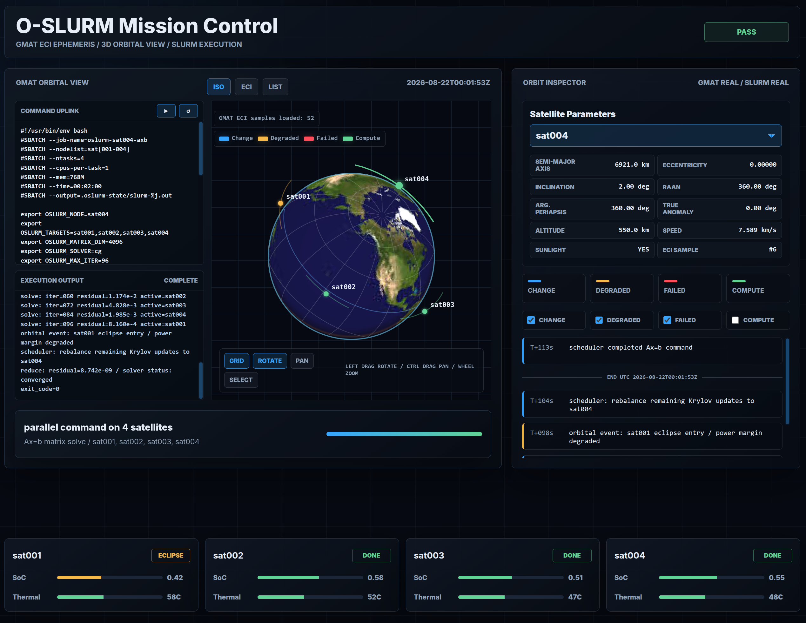

# O-SLURM

The workload manager for computers that don't stay put.



Topology changes.
Sunlight disappears.
Links vanish.
Nodes overheat.
Satellites die.

Your jobs still need to finish.

```bash
make demo
```

Current local result uses `third_party/GMAT-R2026a-fixed` and `third_party/slurm-26.05.3` when available. In this workspace the real closed-loop demo propagates four spacecraft with GMAT, starts four local Slurm satellite nodes, checkpoints a workload on eclipse risk, and restores it on `sat004`.

```text
GMAT ephemeris/events
        |
        v
O-SLURM prediction: topology + power + thermal + reliability
        |
        v
PredictedResourceWindow
        |
        v
O-SLURM scheduler
        |
        v
Slurm queue/lifecycle/node execution
        |
        v
checkpoint + requeue/migration feedback
```

GMAT: orbital dynamics / ephemeris.

O-SLURM: prediction / constraints / scheduling.

Slurm: queue / workload lifecycle / node execution.

## Modules

This repository currently has three complementary tracks:

```text
O-SLURM
  Orbit-aware scheduling layer that turns GMAT events and predicted
  power/thermal/link windows into Slurm placement and migration behavior.

GMAT-Compute
  Scheduler-neutral compute-payload digital twin layer for GMAT-based
  orbital simulation. It models compute hardware, power envelopes,
  thermal coupling, reliability, measured lab profiles, and task progress.

Satellite-Aware Autonomy
  A deterministic, explainable, partition-tolerant satellite-local scheduler
  that uses mission intent, authority leases, local resource windows, compact
  one-hop neighbor advertisements, reservations, and replayable journals.
```

### O-SLURM

O-SLURM is the scheduler-facing layer. It consumes orbital state, predicts
resource windows, and demonstrates checkpoint/restore behavior across local
Slurm satellite nodes.

Current local demo path:

```text
GMAT REAL propagation
        |
        v
O-SLURM resource windows
        |
        v
Slurm REAL sat001..sat004
        |
        v
checkpoint on sat001 eclipse risk
        |
        v
restore on sat004
```

### GMAT-Compute

[`gmat-compute/`](gmat-compute/) is an independent project inside this repo:

> A scheduler-neutral compute-payload extension for orbital mission simulation.

It is not tied to Slurm or O-SLURM. Its core C++ API has no GMAT dependency and
is intended to sit between GMAT and any scheduler, optimizer, MPC/MILP planner,
Python policy, or constellation design tool.

It provides:

- `ComputePayload` C++ core
- `OrbitalEnvironmentState` adapter contract
- measured hardware envelope provider
- power / thermal / reliability models
- workload-normalized task execution
- checkpoint / restore / cancel lifecycle
- scheduler-neutral protobuf API
- Python provider ABI for lab-measured device models
- real GMAT `GmatConsole` adapter
- deterministic `make demo`

Run it independently:

```bash
cd gmat-compute
make test
make demo
```

Current verified GMAT-Compute demo result:

```text
GMAT backend: REAL
ECLIPSE_ENTRY
available compute power=280 W
throughput drops from ~420 to ~126 units/s
Task completed=YES
GMAT ↔ COMPUTE CO-SIM: PASS
```

### Satellite-Aware Autonomy

[`docs/satellite-aware-scheduling.md`](docs/satellite-aware-scheduling.md) describes the autonomous scheduling interface.

This module answers the disconnected constellation case: the ground segment sends a mission intent and authority lease, then each satellite can make bounded local decisions from its own state and direct-neighbor advertisements. The scheduler core does not import Slurm, GMAT, or consensus services.

Implemented pieces:

- `SchedulingIntent` and `AuthorityPolicy`
- compact `SatelliteSchedulingAdvertisement`
- direct-neighbor `NeighborSchedulingTable`
- hard feasibility checks for compute, deadline, energy, thermal, connectivity, advertisement validity, and reservations
- deterministic `MAXIMIZE_WORST_SAFETY_MARGIN` placement rule
- `TaskOffer` / `TaskAcceptance` / `TaskReject` / `TaskCommit`
- reservation lifecycle and idempotent commits
- local execution backend, checkpoint/restore hooks, and replayable execution journal
- `CentralizedBaseline` comparison metrics

Run the satellite-local autonomy demo:

```bash
make satellite-demo
```

The demo uses real GMAT ECI JSON, disconnects ground authority, detects an eclipse-driven local-window risk on `SAT01`, rejects `SAT02` on energy margin, ignores non-direct `SAT04`, and hands the workload to `SAT03` with zero ground-dependent decisions while disconnected.

## Visualization

```bash
make visualize
```

Then open `http://localhost:8080`.

The console loads GMAT ECI ephemeris from `docs/visualization/gmat-events.json`, renders the Earth/orbits in a 3D attitude view, and fills the satellite selector from whatever `node_id` values are present in the data. New satellites can be inspected without changing the UI code as long as their samples are included in that JSON.

The console uses aerospace-style status colors:

- Blue: scheduling or execution change
- Amber: degraded operating condition before failure
- Red: failure event

## Commands

```bash
make test
make demo
make satellite-demo
make visualize
cd gmat-compute && make test && make demo
python3 providers/gmat/adapter.py --scenario providers/gmat/scenarios/leo_demo.yaml --output /tmp/gmat-events.json
```

The GMAT command requires `--allow-mock` for the deterministic fallback. Without that flag, it fails if real GMAT is unavailable.
