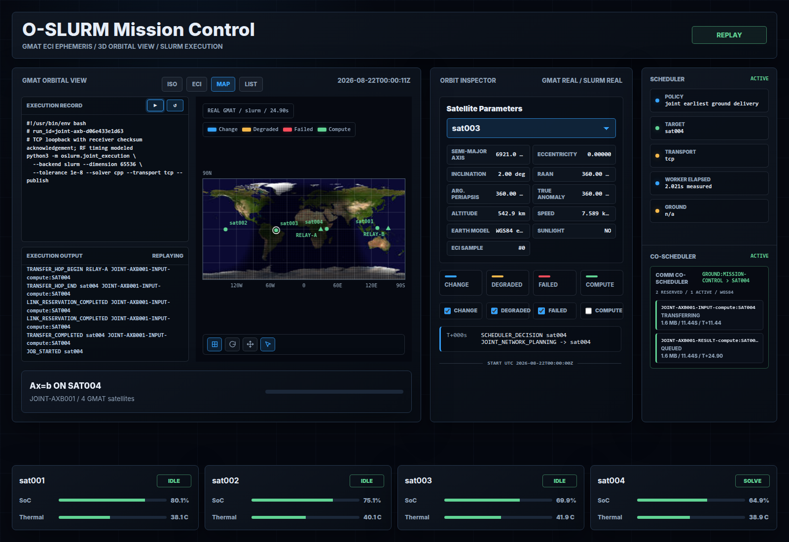

# O-SLURM

The workload manager for computers that don't stay put.


## Current Progress

- Mission Control: 3D orbital and flat-Earth ground-track views, SAT/RELAY
  status lists, recorded full-orbit execution, separate scheduler/co-scheduler
  panels, and evolving analytic SoC/thermal telemetry.
- Real compute: validated matrix-free Ax=b with portable checkpoints, local or
  four-node Slurm execution, and bounded autonomous checkpoint handoffs.
- Joint scheduling: real mission input delivery gates worker execution;
  measured completion replans result delivery, with ground-side hash/residual
  validation before mission completion.
- Dynamic communications: real GMAT compute/relay ephemerides plus rotating
  WGS84 ground sites, native EarthFixed visibility/elevation/range checks,
  JGM2 8x8 + Sun/Luna propagation and GMAT-Comm envelope-based reservations.
- Embedded port: bounded integer C++ decision/lease core with C ABI, event-driven
  wakeup deadlines, RV32IMAC cross-compilation and an optional incremental C++
  Ax=b kernel. See [flight core](flight/README.md).
- Profiling: unified trace, `profile mission` latency attribution, worker/kernel
  overhead separation, contact-generation costs and Perfetto exports.



The dashboard now replays the latest published joint mission, including actual
input/result transfer stages and measured C++ worker completion. Payloads use
real bounded TCP loopback with receiver checksum acknowledgement; RF link timing
and power/thermal telemetry remain analytic, not hardware measurements. Mission
geometry and displayed frame orientation come from GMAT native reports. This is
a higher-fidelity model, not a flight-certified navigation system.

Next: target-board RISC-V timing/power validation, concurrent measured mission
workers, authenticated remote transport and sensor/covariance models. See
[joint scheduling](docs/joint-scheduling.md) and [full-orbit Ax=b](docs/orbit-axb.md)
for reproducible commands and current limits.

Latest engineering regression record: [2026-11-17 validation](docs/validation-2026-11-17.md).
Run `make joint-axb-cpp` to execute and publish the C++/TCP mission, and
`make regression` for the host, cross-build, transport and browser checks.

## Overview

Topology changes.
Sunlight disappears.
Links vanish.
Nodes overheat.
Satellites die.

Your jobs still need to finish.

```bash
make demo
```

Current local result uses `third_party/GMAT-R2026a-fixed` and `third_party/slurm-26.05.3` when available. In this workspace the real closed-loop demo propagates four spacecraft with GMAT, starts four local Slurm satellite nodes, checkpoints a workload on eclipse risk, and restores it on `sat004`.

```text
GMAT ephemeris/events
        |
        v
O-SLURM prediction: topology + power + thermal + reliability
        |
        v
PredictedResourceWindow
        |
        v
O-SLURM scheduler
        |
        v
Slurm queue/lifecycle/node execution
        |
        v
checkpoint + requeue/migration feedback
```

GMAT: orbital dynamics / ephemeris.

O-SLURM: prediction / constraints / scheduling.

Slurm: queue / workload lifecycle / node execution.

## Modules

This repository currently has five complementary tracks:

```text
O-SLURM
  Orbit-aware scheduling layer that turns GMAT events and predicted
  power/thermal/link windows into Slurm placement and migration behavior.

GMAT-Compute
  Scheduler-neutral compute-payload digital twin layer for GMAT-based
  orbital simulation. It models compute hardware, power envelopes,
  thermal coupling, reliability, measured lab profiles, and task progress.

GMAT-Comm
  Scheduler-neutral communication-payload layer that turns GMAT-derived
  ECI geometry and terminal envelope profiles into contact windows, transfer
  plans, reservations, and route explanations.

Satellite-Aware Autonomy
  A deterministic, explainable, partition-tolerant satellite-local scheduler
  that uses mission intent, authority leases, local resource windows, compact
  one-hop neighbor advertisements, reservations, and replayable journals.

Multi-Constellation Co-Scheduling
  O-SLURM-side network model for compute, relay, access, and ground domains.
  It jointly ranks compute placement and input/result transfer feasibility.
```

### O-SLURM

O-SLURM is the scheduler-facing layer. It consumes orbital state, predicts
resource windows, and demonstrates checkpoint/restore behavior across local
Slurm satellite nodes.

Current local demo path:

```text
GMAT REAL propagation
        |
        v
O-SLURM resource windows
        |
        v
Slurm REAL sat001..sat004
        |
        v
checkpoint on sat001 eclipse risk
        |
        v
restore on sat004
```

### GMAT-Compute

[`gmat-compute/`](gmat-compute/) is an independent project inside this repo:

> A scheduler-neutral compute-payload extension for orbital mission simulation.

It is not tied to Slurm or O-SLURM. Its core C++ API has no GMAT dependency and
is intended to sit between GMAT and any scheduler, optimizer, MPC/MILP planner,
Python policy, or constellation design tool.

It provides:

- `ComputePayload` C++ core
- `OrbitalEnvironmentState` adapter contract
- measured hardware envelope provider
- power / thermal / reliability models
- workload-normalized task execution
- checkpoint / restore / cancel lifecycle
- scheduler-neutral protobuf API
- Python provider ABI for lab-measured device models
- real GMAT `GmatConsole` adapter
- deterministic `make demo`

Run it independently:

```bash
cd gmat-compute
make test
make demo
```

Current verified GMAT-Compute demo result:

```text
GMAT backend: REAL
ECLIPSE_ENTRY
available compute power=280 W
throughput drops from ~420 to ~126 units/s
Task completed=YES
GMAT ↔ COMPUTE CO-SIM: PASS
```

### GMAT-Comm

[`gmat-comm/`](gmat-comm/) is the companion communication-payload module:

> A scheduler-neutral communication-payload and contact-planning layer for GMAT-based mission simulation.

It is not tied to Slurm. Its C++ core has no GMAT headers and can be used by GMAT, O-SLURM, Python studies, or a future service boundary.

It provides:

- communication terminals and payload state
- analytic and measured communication envelope providers
- bandwidth / latency / packet-loss / acquisition / power curves
- contact windows and conservative transfer capacity
- buffer and reservation lifecycle
- direct and temporal store-carry-forward route planning
- Python provider ABI
- GMAT ECI JSON geometry adapter
- protobuf interface draft
- deterministic C++ and Python tests

Run it independently:

```bash
make -C gmat-comm test
make -C gmat-comm demo
```

The current GMAT integration path is intentionally adapter-based:

```text
GMAT/O-SLURM ECI JSON
        |
        v
GMAT-Comm geometry adapter
        |
        v
contact windows + communication envelopes
        |
        v
O-SLURM network and joint planner
```

### Satellite-Aware Autonomy

[`docs/satellite-aware-scheduling.md`](docs/satellite-aware-scheduling.md) describes the autonomous scheduling interface.

This module answers the disconnected constellation case: the ground segment sends a mission intent and authority lease, then each satellite can make bounded local decisions from its own state and direct-neighbor advertisements. The scheduler core does not import Slurm, GMAT, or consensus services.

Implemented pieces:

- `SchedulingIntent` and `AuthorityPolicy`
- compact `SatelliteSchedulingAdvertisement`
- direct-neighbor `NeighborSchedulingTable`
- hard feasibility checks for compute, deadline, energy, thermal, connectivity, advertisement validity, and reservations
- deterministic `MAXIMIZE_WORST_SAFETY_MARGIN` placement rule
- `TaskOffer` / `TaskAcceptance` / `TaskReject` / `TaskCommit`
- reservation lifecycle and idempotent commits
- local execution backend, checkpoint/restore hooks, and replayable execution journal
- `CentralizedBaseline` comparison metrics

Run the satellite-local autonomy demo:

```bash
make satellite-demo
```

The demo uses real GMAT ECI JSON, disconnects ground authority, detects an eclipse-driven local-window risk on `SAT01`, rejects `SAT02` on energy margin, ignores non-direct `SAT04`, and hands the workload to `SAT03` with zero ground-dependent decisions while disconnected.

## Visualization

```bash
make visualize
```

Then open `http://localhost:8081`.

The console loads GMAT ECI ephemeris from `docs/visualization/gmat-events.json`, renders the Earth/orbits in a 3D attitude view, and fills the satellite selector from whatever `node_id` values are present in the data. New satellites can be inspected without changing the UI code as long as their samples are included in that JSON.

The console uses aerospace-style status colors:

- Blue: scheduling or execution change
- Amber: degraded operating condition before failure
- Red: failure event

## Flight Recorder & Profiling

For a real matrix solve spanning a full GMAT orbit, with checkpoint migration
and a replay generated from the same run:

```bash
python3 -m pip install -r requirements.txt
make orbit-axb
make visualize
```

The default backend performs real numerical work locally; use
`python3 -m oslurm.orbit_benchmark --backend slurm --publish` for real Slurm
execution. [Full-orbit experiment](docs/orbit-axb.md) documents the clock model,
baseline, reports, and current communication limitations. The browser replays
recorded results; it does not submit jobs itself.

Checkpoint migration now defaults to GMAT-Comm contact planning and reservations.
Actual checkpoint bytes, relay buffer capacity, half-duplex terminal occupancy,
acquisition, transmission, propagation and contact waiting all affect the same
simulation clock. RELAY-A/B are propagated with GMAT. Use
`--checkpoint-transport shared` for the zero-radio-cost baseline.

The default orbit benchmark now uses the satellite-local `autonomous` policy,
modeled battery/thermal forecasts, authority leases and peer offer/commit handoffs.
The console adds a MAP ground-track view and replays SoC/temperature snapshots
from the same run; model provenance is available in the metric tooltips.

O-SLURM includes a structured simulation flight recorder for profiling runs. It separates wall-clock time, simulation time, and deterministic event sequence, then streams JSONL traces under `profiles/<run-id>/`.

Run a real GMAT-backed satellite-autonomy profiling session through the CLI handlers:

```bash
printf 'profile on --mode full --run-id profile001\nrun satellite-demo\nprofile summary\nprofile topology\nprofile scheduler\nprofile bottleneck constellation\nprofile failures\nprofile off\n' | python3 -m oslurm.cli
```

Generated files:

```text
profiles/<run-id>/
  manifest.json
  events.jsonl
  snapshots.jsonl
  metrics.json
  bottlenecks.json
  failures.jsonl
  trace.json
  topology_epochs.json
```

Useful commands:

```bash
python3 -m oslurm.cli profile status
python3 -m oslurm.cli profile summary
python3 -m oslurm.cli profile topology
python3 -m oslurm.cli profile scheduler
python3 -m oslurm.cli profile network
python3 -m oslurm.cli profile bottleneck joint
python3 -m oslurm.cli profile job 381
python3 -m oslurm.cli profile timeline 381
python3 -m oslurm.cli profile cause 381
python3 -m oslurm.cli profile export trace.json --time-axis simulation
python3 -m oslurm.cli profile replay profiles/profile001
python3 -m oslurm.cli montecarlo run satellite-autonomy --runs 10 --seed 42
python3 -m oslurm.cli montecarlo worst
```

The first implementation records orbital, topology, node-state, power, thermal, prediction, job, scheduler, protocol, failure, recovery, performance, ground, simulation, communication-link, transfer, reservation, and joint-planner events. It also records scheduler candidate rejection causes, operation-regime intervals, stranded compute, topology churn, network transfer plans, buffered bytes, profile overhead, replay digests, Perfetto/Chrome trace JSON export, node/job CSV exports, and reproducible Monte Carlo campaign summaries.

## Multi-Constellation Networking

O-SLURM now includes a network model under [`oslurm/network/`](oslurm/network/) that co-schedules compute and communication resources across compute spacecraft, communication relays, access links, and ground mission-control endpoints.

The CLI can load compute and relay constellations, connect them, submit a mission job, reserve input/result transfer paths, and profile network bottlenecks.

Run the joint compute/network scenario:

```bash
printf 'load constellation compute configs/compute-ai.yaml
load constellation comm configs/relay-public.yaml
connect constellations compute-ai relay-public
profile on --mode full --run-id joint-dev
submit job workloads/inference.yaml
run 2h
show transfers
profile network
profile bottleneck joint
profile timeline JOB001
profile off
' | python3 -m oslurm.cli
```

The default scenario selects `compute:SAT003` even though it is slower than `compute:SAT001`, because the relay-assisted input/result route gives the earliest end-to-end mission completion.

Run `make joint-demo` for the incremental two-job scenario using both Relay-A
and Relay-B. It now checks configured power/thermal bounds and compute queue
availability, atomically reserves upload/downlink paths, and separates compute
completion from ground delivery. Inspect progress with `show jobs` and decisions
with `scheduler explain job JOB001`.

`make joint-demo` models compute and radio timing. For a real Ax=b mission, run
`make joint-axb` or `python3 -m oslurm.joint_execution --backend slurm`: the joint
decision drives worker placement, input delivery gates execution, measured
completion triggers downlink replanning, and the ground verifies the result.
The single-mission runner now defaults to real GMAT-derived dynamic contact
windows with rotating WGS84 ground sites, elevation/range/occultation checks,
and GMAT-Comm link envelopes. Radio timing remains simulated. `profile mission`
and `mission-profile.json` separate window waits, transfer occupancy, measured
worker time and host-only planning costs. See
[joint scheduling](docs/joint-scheduling.md) for configuration and limitations.

## Commands

```bash
make test
make demo
make satellite-demo
make visualize
make profile-smoke
make -C gmat-comm test
cd gmat-compute && make test && make demo
python3 providers/gmat/adapter.py --scenario providers/gmat/scenarios/leo_demo.yaml --output /tmp/gmat-events.json
```

The GMAT command requires `--allow-mock` for the deterministic fallback. Without that flag, it fails if real GMAT is unavailable.
