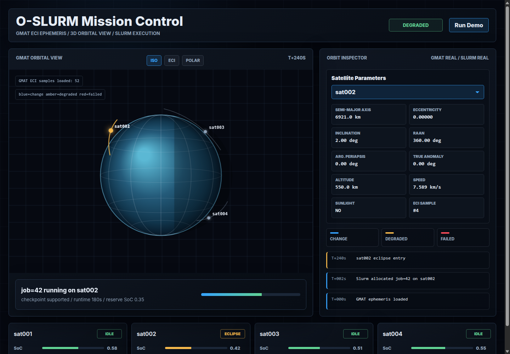

# O-SLURM

The workload manager for computers that don't stay put.



Topology changes.
Sunlight disappears.
Links vanish.
Nodes overheat.
Satellites die.

Your jobs still need to finish.

```bash
make demo
```

Current local result uses `third_party/GMAT-R2026a-fixed` and `third_party/slurm-26.05.3` when available. In this workspace the real closed-loop demo propagates four spacecraft with GMAT, starts four local Slurm satellite nodes, checkpoints a workload on eclipse risk, and restores it on `sat004`.

```text
GMAT ephemeris/events
        |
        v
O-SLURM prediction: topology + power + thermal + reliability
        |
        v
PredictedResourceWindow
        |
        v
O-SLURM scheduler
        |
        v
Slurm queue/lifecycle/node execution
        |
        v
checkpoint + requeue/migration feedback
```

GMAT: orbital dynamics / ephemeris.

O-SLURM: prediction / constraints / scheduling.

Slurm: queue / workload lifecycle / node execution.

## Visualization

```bash
make visualize
```

Then open `http://localhost:8080`.

The console loads GMAT ECI ephemeris from `docs/visualization/gmat-events.json`, renders the Earth/orbits in a 3D attitude view, and fills the satellite selector from whatever `node_id` values are present in the data. New satellites can be inspected without changing the UI code as long as their samples are included in that JSON.

The console uses aerospace-style status colors:

- Blue: scheduling or execution change
- Amber: degraded operating condition before failure
- Red: failure event

## Commands

```bash
make test
make demo
make visualize
python3 providers/gmat/adapter.py --scenario providers/gmat/scenarios/leo_demo.yaml --output /tmp/gmat-events.json
```

The GMAT command requires `--allow-mock` for the deterministic fallback. Without that flag, it fails if real GMAT is unavailable.
